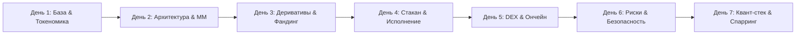

# Регламент обучения менеджеров: NULLSPREAD Research & Sales Academy

Данный документ описывает пошаговую методологию подготовки менеджеров по продажам и клиентских консультантов платформы **NULLSPREAD** на основе сформированной базы знаний (7 тематических модулей + продуктовый периметр).

---

## 🎯 1. Цель и концепция обучения

**Главная задача:** превратить менеджера из «продавца по скрипту» в **квалифицированного квант-консультанта**, способного на равных общаться с опытными инвесторами и фондами с чеками от **$50,000+**.

### Ключевые принципы коммуникации NULLSPREAD:
1. **Никаких гарантий и пустых обещаний:** Менеджер никогда не называет фиксированных процентов доходности и не заявляет о «100% защите депозита».
2. **Опора на институциональную микроструктуру:** Вместо розничной терминологии («киты», «памп», «индикаторы») менеджер говорит языком реального рынка (дельта-нейтральный базис, ставка финансирования, глубина стакана $L2/L3$, проскальзывание, латентность).
3. **Бесшовная связка с лендингом:** Любой сложный технический тезис заканчивается ссылкой на соответствующий блок платформы (`B/02`, `C/03`, `M/01`, `R/01–R/04`).

---

## 📦 2. Что находится на руках у обучающегося

Вся база упакована в директорию `exports/notebooklm_pack/` в виде **9 автономных источников**:

| № | Файл | Назначение |
|---|---|---|
| **0** | `00_PRODUCT_CLAIMS_AND_LANDING.md` | Фундамент: официальные продуктовые границы, термины, факты лендинга |
| **0** | `00_SALES_OBJECTIONS.md` | Матрица из 10+ жестких клиентских возражений и запрещенные фразы |
| **1** | `Day_1_00_Fundamentals.md` | Блокчейн, мемпул, газ, типы токенов, стейблкоины, токеномика (256 КБ) |
| **2** | `Day_2_01_Market_Structure.md` | Архитектура криптобирж, маркет-мейкеры, фрагментация, CEX vs DEX |
| **3** | `Day_3_02_Arbitrage_and_Derivatives.md` | Спот vs фьючерсы, фандинг, дельта-нейтральность, базис, виды арбитража |
| **4** | `Day_4_03_Orderbook_and_Execution.md` | Биржевой стакан, сведение ордеров, мейкер/тейкер, спреды, Wash Trading |
| **5** | `Day_5_04_DEX_and_Onchain.md` | Пулы ликвидности, AMM, ончейн-клиринг, задержки транзакций, кошельки |
| **6** | `Day_6_05_Risks_and_Security.md` | Хеджирование, риски исполнения, закрытый вывод, комплаенс AML/KYT |
| **7** | `Day_7_06_Quant_Stack.md` | Торговый стек, скринеры, психология инвестора, боевые скрипты продаж |
| **+** | `README_NOTEBOOKLM_GUIDE.md` | Готовые промпты для генерации подкастов и спарринг-сессий |

---

## 📅 3. Программа 7-дневного интенсива

Обучение рассчитано на **7 рабочих дней** (по 1 модулю в день).



---

## ⏱ 4. Дневной распорядок менеджера (3 этапа)

Каждый рабочий день делится на три сфокусированных блока суммарной длительностью **1.5 часа**:

```
 ┌─────────────────────────────────────────────────────────┐
 │ 09:00 - 09:25 | УТРО: Аудиальное погружение             │
 │                 (Слушаем AI-подкаст в NotebookLM)       │
 ├─────────────────────────────────────────────────────────┤
 │ 14:00 - 14:45 | ДЕНЬ: Текстовый разбор и видео-пруфы    │
 │                 (Конспект DeepSeek + таймкоды YouTube)  │
 ├─────────────────────────────────────────────────────────┤
 │ 17:30 - 18:00 | ВЕЧЕР: Боевая аттестация и спарринг     │
 │                 (Чат NotebookLM + CLI Sales Academy)    │
 └─────────────────────────────────────────────────────────┘
```

### Этап 1. Утро — Аудиальное погружение (20–25 минут)
* **Инструмент:** Google NotebookLM.
* **Действие:** 
  1. В левой панели блокнота отмечаются галочками ровно два источника:
     * `[x] 00_PRODUCT_CLAIMS_AND_LANDING.md`
     * `[x] Day_X_...md` (модуль текущего дня).
  2. Нажимается кнопка **Customize** в разделе **Audio Overview** и вставляется целевой промпт:
     > *«Обсуждайте материал на русском языке от лица двух опытных крипто-практиков. Сделайте акцент на том, как эти технические механизмы применять в общении со скептичным крупным инвестором. Разберите заблуждения розничных трейдеров и свяжите тему с аналитикой деска NULLSPREAD. Без воды».*
  3. Менеджер слушает 12–15 минутный подкаст (в наушниках по дороге в офис или за утренним кофе).
* **Результат:** Формируется общая ментальная карта темы, термины перестают пугать, появляется естественная интонация для обсуждения сложных концепций.

---

### Этап 2. День — Активный разбор конспекта и видео-пруфов (40–45 минут)
* **Инструмент:** Markdown-файл текущего дня (`Day_X_...md`).
* **Фокус внимания менеджера:**
  1. **Bilingual Glossary (Терминология):** Как англоязычный институциональный термин звучит на сленге русскоязычных трейдеров и институционалов.
  2. **Sales Translation Bridge:** Главный раздел для продаж. Построен по формуле:
     * *Что думает клиент:* типовое заблуждение («Арбитраж — это кнопка бабло без риска»).
     * *Как устроено на самом деле:* суровая физика рынка (спреды схлопываются ботами, есть проскальзывание и риски бирж).
     * *Образцовый ответ менеджера:* готовый скрипт с отсылкой к блоку лендинга:
       * `B/02` — когда речь идет о спредах и нодах;
       * `C/03` — когда клиент спрашивает про математику кейса $2,200 и комиссии;
       * `M/01` — когда обсуждаются накрученные объемы (Wash Trading);
       * `R/01–R/04` — когда клиент сомневается в рисках.
  3. **Видео-пруфы по таймкодам `[MM:SS]`:** Менеджер открывает 2-3 ссылки прямо на YouTube, чтобы своими глазами увидеть реальный стакан ордеров, график спреда в TradingView или интерфейс пула ликвидности.

---

### Этап 3. Вечер — Интерактивный спарринг и аттестация (25–30 минут)

Проверка готовности проходит на двух независимых тренажерах:

#### А. Спарринг в чате Google NotebookLM
Менеджер пишет в чат блокнота:
> *«Действуй как жесткий, скептичный криптоинвестор с капиталом $200,000, который обжигался на скамах и не верит в арбитраж. Задай мне 3 самых каверзных вопроса строго по сегодняшнему модулю, по одному вопросу за раз. Оценивай мои ответы на соответствие материалам и фактам платформы NULLSPREAD».*

Менеджер тренируется отвечать без запинок и без обещания гарантий.

#### Б. Консольный тренажер академии (CLI)
Менеджер запускает автоматизированную аттестацию в терминале:

```bash
# 1. Экспресс-тест на знание матчасти дня
python -m research_academy.cli academy quiz --topic 01_market_structure

# 2. Боевой ролевой спарринг со скептиком повышенной сложности
python -m research_academy.cli academy roleplay --difficulty hard
```

**Как работает оценка:**
* Если менеджер использовал стоп-слова (*«мы гарантируем»*, *«безрисковый доход»*, *«100% депозит сохранен»*), система фиксирует **КРИТИЧЕСКУЮ ОШИБКУ** и немедленно проваливает аттестацию.
* Если аргументация построена на глубине стакана, комиссиях и меморандуме о рисках — начисляется проходной балл ($8–10 / 10$).

---

## 🛡 5. Использование материалов во время реальных звонков

После прохождения 7-дневного цикла файлы базы становятся **живой интерактивной шпаргалкой**:

1. **Экран звонка:** На втором мониторе у менеджера открыт `00_SALES_OBJECTIONS.md`.
2. **Поиск по горячим клавишам (`Ctrl + F`):** 
   * Клиент говорит: *«А если биржа соскамится как FTX?»* → Менеджер вводит `FTX` и сразу видит блок `R/04` и аргумент про раздельное хранение и отсутствие кастоди.
   * Клиент говорит: *«На Bybit цена одна, а на Uniswap другая, я сам руками перекину!»* → Менеджер вводит `DEX` и аргументирует через комиссию за газ в сети Ethereum и время подтверждения блока.

---

## 📊 6. Критерии допуска к звонкам (Чек-лист аттестации)

Менеджер считается готовым к выходу на реальный трафик, если:
- [ ] Прослушаны все 7 аудио-подкастов по модулям.
- [ ] В интерактивном спарринге NotebookLM получена оценка не ниже «Уверенно / Аргументированно» по всем 7 дням.
- [ ] Успешно пройден консольный спарринг: `research academy roleplay --difficulty hard` без критических ошибок.
- [ ] Менеджер наизусть знает привязку ключевых блоков лендинга (`B/02`, `C/03`, `M/01`, `R/01–R/04`).
- [ ] Ни в одном тренировочном диалоге не было дано обещаний фиксированной доходности.

