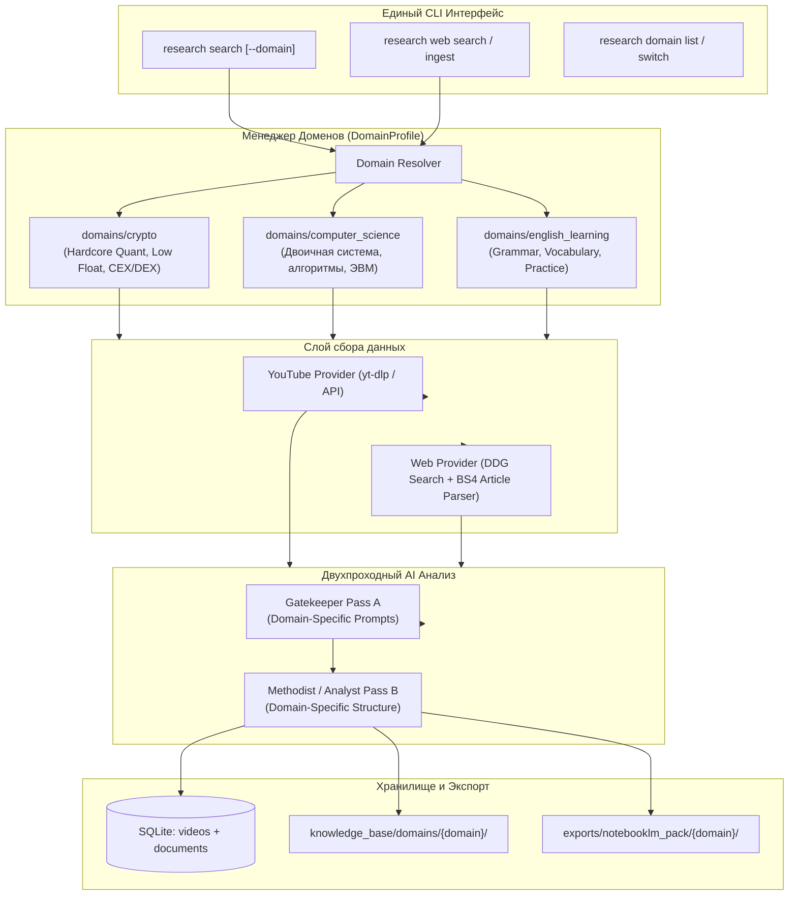

# Архитектурный план: Мультидоменная модульность и парсинг первичных веб-источников

## 🎯 Описание цели

Трансформация проекта `yt2notebooklm` (`nullspread-research-academy`) из монолитной системы, жестко завязанной на YouTube и крипто-тематику деска NULLSPREAD, в **универсальный многодоменный движок сбора и верификации знаний**.

### Ключевые возможности после доработки:
1. **Парсинг первичных веб-источников (Web & Primary Sources):**
   * Сбор информации не только из видео и транскриптов YouTube, но и из первичных текстовых веб-источников: статей, официальной документации, научных публикаций, конспектов и Wikipedia.
   * Очистка веб-страниц от навигации, рекламы и шума с преобразованием в структурированный текст/Markdown с сохранением заголовков и разделов.
   * Поиск первичных источников по запросам через встроенный веб-поиск (без необходимости платных API ключей, на базе доступных библиотек).
2. **Мультидоменная изоляция (Domain Profiles):**
   * Возможность параллельной работы с совершенно разными сферами знаний без смешивания:
     * **`crypto`** (Syndicate Intelligence / NULLSPREAD) — полностью изолирован и защищен от изменений;
     * **`computer_science`** — академические темы, дискретная математика, архитектура ЭВМ, двоичная система счисления, IEEE 754;
     * **`english_learning`** — грамматика, лексика, идиомы, транскрипты носителей языка;
     * **Пользовательские домены** — создание нового домена за 2 минуты (добавлением папки конфигурации).
3. **100% сохранение наработок по крипте (Zero Regressions):**
   * Все 39 существующих юнит-тестов продолжают выполняться успешно.
   * Все сформированные конспекты (`knowledge_base/sources/`), база данных SQLite и пакеты `exports/notebooklm_pack/` остаются неприкосновенными и обратно-совместимыми.

---

## 👥 Требуется согласование с пользователем (User Review Required)

> [!IMPORTANT]
> **1. Размещение профилей доменов**
> Предлагается вынести профили в отдельную модульную директорию `domains/` в корне проекта:
> - `domains/crypto/` — инкапсулирует крипто-матрицу, промпты Quant Gatekeeper/Methodist, продуктовые границы и каналы.
> - `domains/computer_science/` — новый домен с темами по информатике (включая тему «Двоичная система счисления и побитовая арифметика»).
> - `domains/english_learning/` — домен для изучения языка.
> При этом старые пути в `config/` и `knowledge_base/` остаются рабочими для полной обратной совместимости.

> [!TIP]
> **2. Источники веб-поиска и парсинга**
> В окружении Python уже установлены и проверены библиотеки `requests`, `httpx`, `beautifulsoup4` и `duckduckgo_search`. 
> Это позволяет:
> - Находить первоисточники в интернете напрямую по текстовым запросам без привязки к Google/SerpAPI ключам;
> - Извлекать чистый контент по прямым URL (статьи, туториалы, лекции) через BeautifulSoup4 и селекторы основного контента (`<article>`, `<main>`, `.content`).

---

## ❓ Открытые вопросы (Open Questions)

> [!WARNING]
> 1. **Переключение активного домена:**
>    Как вам удобнее переключаться между направлениями?
>    - **Вариант А (Рекомендуемый):** Флаг `--domain <name>` в любой CLI-команде (например, `research search --domain computer_science`), а при отсутствии флага — используется домен по умолчанию (`crypto` или значение из `.env`).
>    - **Вариант B:** Явная команда `research domain switch <name>`, которая переключает текущий профиль в локальном состоянии.
>
> 2. **Стартовая тема по двоичной системе счисления:**
>    Для профиля `computer_science` мы подготовим модуль:
>    - Название: *«Позиционные системы счисления, двоичная арифметика и машинное представление данных»*.
>    - Подтемы: перевод между 2/8/10/16 системами, прямой/обратный/дополнительный код, переполнение разрядной сетки, формат чисел с плавающей запятой IEEE 754, побитовые операции (AND, OR, XOR, сдвиги).
>    Подходит ли такая декомпозиция для вашего реферата?

---

## 📐 Предлагаемые изменения (Proposed Changes)



---

### 1. Доменная архитектура и инкапсуляция

#### [NEW] `src/research_academy/domain/profile.py`
Модель конфигурации домена:
- `id`: уникальный идентификатор домена (`crypto`, `computer_science`, `english_learning`);
- `name`: понятное название домена;
- `description`: назначение;
- `gatekeeper_prompt`: системный промпт для отсева шлака под специфику домена;
- `methodist_prompt`: системный промпт для глубокой деконструкции знаний;
- `topics`: список тем и поисковых матриц;
- `trusted_sources`: белый список доменов и YouTube-каналов;
- `claims_verifier_rules`: правила проверки фактов и анти-галлюцинаций.

#### [NEW] `src/research_academy/domain/manager.py`
Менеджер доменов:
- Обнаруживает и загружает профили из директории `domains/`;
- Поддерживает обратную совместимость: если папка `domains/crypto` не найдена, автоматически собирает ее из существующих `config/topics.yaml`, `config/scoring.yaml` и `prompts.py`;
- Предоставляет методы `get_domain(domain_id)` и `list_domains()`.

#### [NEW] `domains/crypto/`
Полная инкапсуляция текущего крипто-контура:
- `domain.yaml`: параметры крипто-деска;
- `topics.yaml`: 7 модулей Syndicate Intelligence;
- `prompts.py`: сохраненные системные промпты Forensic Quant Gatekeeper и Sales Methodist;
- `claims/PRODUCT_CLAIMS.md`: продуктовые границы NULLSPREAD.

#### [NEW] `domains/computer_science/`
Конфигурация для рефератов и изучения фундаментальной информатики:
- `domain.yaml`: ориентация на академическую строгость, битовую точность и формулы;
- `topics.yaml`: модуль по двоичной системе счисления, побитовым операциям и представлению чисел;
- `prompts.py`:
  - **Academic CS Gatekeeper:** отсекает поверхностные ролики/статьи уровня «двоичный код это 0 и 1 в матрице», требует демонстрации расчетов, схемотехники и побитовой логики;
  - **CS Methodist:** 4 слоя (*Математический фундамент $\rightarrow$ Доказательства и расчеты $\rightarrow$ Подводные камни (переполнение разрядности, потеря знака) $\rightarrow$ Практика в программировании и микропроцессорах*).

---

### 2. Подсистема парсинга первичных веб-источников

#### [NEW] `src/research_academy/providers/web_provider.py`
Класс `WebSearchProvider`:
- Поиск страниц по поисковому запросу темы через `duckduckgo_search` (без API-ключей);
- Фильтрация подозрительных доменов (дорвеи, контентные фермы, спам).

#### [NEW] `src/research_academy/providers/web_extractor.py`
Класс `WebArticleExtractor`:
- Загрузка HTML с обработкой таймаутов и User-Agent через `httpx`/`requests`;
- Извлечение заголовка, автора, даты публикации;
- Удаление тегов скриптов, стилей, баннеров, футеров и навигации с помощью `BeautifulSoup`;
- Преобразование контента в структурированный Markdown с сохранением логических секций (`# Header`, списки, формулы);
- Нарезка на именованные текстовые сегменты (аналог таймкодов видео) для точного цитирования утверждений.

#### [NEW] `src/research_academy/pipeline/web_harvester.py`
Координатор сбора веб-источников:
- `harvest_web_topic(topic_id, max_results)` — поиск и извлечение кандидатов;
- `ingest_direct_url(url, topic_id)` — прямое добавление любой указанной пользователем статьи/документа в пайплайн обработки.

---

### 3. Модели данных и база данных (Обратная совместимость)

#### [MODIFY] [`src/research_academy/models.py`](file:///c:/Users/root/Desktop/_Intelligence/nullspread-research-academy/src/research_academy/models.py)
- Добавление общей модели документа `WebDocumentMetadata`:
  - `document_id`: хэш или уникальный slug URL;
  - `url`, `title`, `author_or_domain`, `published_at`;
  - `domain`: идентификатор домена (default: `crypto`);
  - `topic_id`: тема;
  - `raw_content`, `clean_markdown`, `word_count`;
  - `discovery_status`: статус обработки.
- Унифицированный интерфейс `SourceContent`: позволяет пайплайну анализа единообразно обрабатывать как `VideoTranscript`, так и `WebDocument`.

#### [MODIFY] [`src/research_academy/database.py`](file:///c:/Users/root/Desktop/_Intelligence/nullspread-research-academy/src/research_academy/database.py)
- Добавление новой таблицы `documents` без изменения существующих таблиц:
  ```sql
  CREATE TABLE IF NOT EXISTS documents (
      document_id TEXT PRIMARY KEY,
      domain TEXT NOT NULL DEFAULT 'crypto',
      topic_id TEXT NOT NULL,
      url TEXT NOT NULL,
      title TEXT NOT NULL,
      source_type TEXT NOT NULL,
      author_or_domain TEXT,
      published_at TEXT,
      clean_markdown TEXT NOT NULL,
      word_count INTEGER NOT NULL,
      discovery_status TEXT NOT NULL,
      status_reason TEXT,
      created_at TEXT NOT NULL,
      updated_at TEXT NOT NULL
  );
  ```
- Добавление колонки `domain TEXT DEFAULT 'crypto'` в таблицу `videos` (через безопасную проверку `PRAGMA table_info`).
- Методы: `upsert_document()`, `get_document()`, `list_documents()`, `save_document_evaluation()`.

---

### 4. Пайплайн анализа и публикации

#### [MODIFY] [`src/research_academy/pipeline/analysis.py`](file:///c:/Users/root/Desktop/_Intelligence/nullspread-research-academy/src/research_academy/pipeline/analysis.py)
- Поддержка передачи `DomainProfile` в `AnalysisPipeline`:
  - При запуске Pass A и Pass B используются промпты активного домена;
  - Метод `run_two_pass_document_analysis(doc)` для оценки веб-источников по тем же критериям качества (релевантность, глубина, отсутствие воды).

#### [MODIFY] [`src/research_academy/pipeline/publishing.py`](file:///c:/Users/root/Desktop/_Intelligence/nullspread-research-academy/src/research_academy/pipeline/publishing.py)
- Изоляция выходных файлов по доменам:
  - Markdown-файлы веб-источников сохраняются в `knowledge_base/domains/{domain}/sources/{id}.md` (для крипты сохраняется обратная совместимость с `knowledge_base/sources/`).
  - Пакеты для NotebookLM формируются в `exports/notebooklm_pack/{domain}/`.

---

### 5. CLI и пользовательские команды

#### [MODIFY] [`src/research_academy/cli.py`](file:///c:/Users/root/Desktop/_Intelligence/nullspread-research-academy/src/research_academy/cli.py)
Новые и расширенные команды:
1. `research domain list` — просмотр доступных доменов (`crypto`, `computer_science`, `english_learning`).
2. `research domain info <domain>` — сводка по темам и матрице выбранного домена.
3. `research web search --domain computer_science --topic binary_system` — автоматический поиск первичных веб-источников.
4. `research web ingest <URL> --domain computer_science --topic binary_system` — мгновенный парсинг конкретной веб-страницы или статьи с запуском 2-проходного AI-анализа.
5. Существующие команды (`research doctor`, `research status`, `research process`, `research search`) получают опциональный аргумент `--domain` (по умолчанию `crypto`).

---

## 🧪 План верификации (Verification Plan)

### Автоматические тесты
1. **Регрессионное тестирование:**
   * Запуск всех 39 существующих тестов для подтверждения того, что крипто-функционал нигде не задет:
     ```bash
     python -m pytest
     ```
2. **Новые модульные тесты:**
   * `tests/test_domain_manager.py`:
     * Тест корректной загрузки домена по умолчанию (`crypto`);
     * Тест изоляции промптов и конфигураций между доменами `crypto` и `computer_science`;
     * Тест обратной совместимости при отсутствии явного указания домена.
   * `tests/test_web_provider.py`:
     * Тест извлечения чистого контента из HTML через `WebArticleExtractor` (отсечение рекламы, извлечение заголовка, разметка на параграфы);
     * Мок-тест поиска веб-источников через `WebSearchProvider`.
   * `tests/test_document_pipeline.py`:
     * Тест 2-проходного анализа веб-документа с сохранением в базу и экспортом в Markdown.

### Ручная верификация пользователем
1. Проверка списка доменов:
   ```bash
   python -m research_academy.cli domain list
   ```
2. Поиск и парсинг информации по двоичной системе счисления:
   ```bash
   python -m research_academy.cli web ingest "https://ru.wikipedia.org/wiki/Двоичная_система_счисления" --domain computer_science --topic binary_numeral_system
   ```
3. Проверка созданного учебного конспекта в `knowledge_base/domains/computer_science/sources/` и экспорт в NotebookLM.
