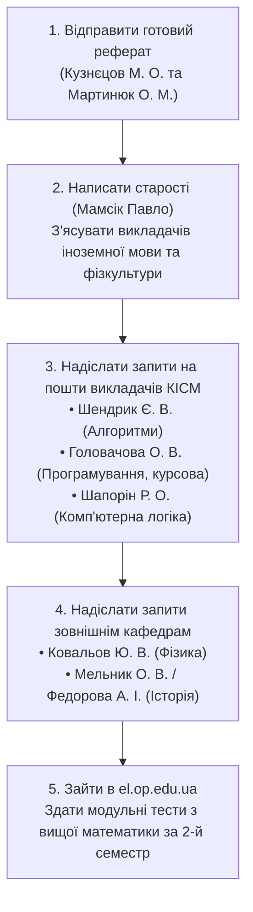

# Довідник викладачів, предметів та академічної заборгованості
## Національний університет «Одеська політехніка» - Інститут комп'ютерних систем
### Кафедра комп'ютерних інтелектуальних систем та мереж (КІСМ)
**Студент:** Рудік Лев Олексійович | **Група:** АМ-251 | **Спеціальність:** 123 «Комп'ютерна інженерія»

---

## 1. Співставлення записів із деканату та бази викладачів

На основі фотографій рукописних нотаток із деканату та вихідного коду сторінки кафедри КІСМ (`op.edu.ua/kaf-kism/staff`) проведено повну ідентифікацію викладачів, дисциплін та контактних даних.

### Заборгованість за 1-й семестр (Листи 1 та 2)

| № | Дисципліна в записці | Викладач у записці | Офіційні дані викладача | Кафедра | Контактний Email | Що потрібно зробити (Статус) |
|---|---|---|---|---|---|---|
| **-** | **Вища математика** | - | - | Кафедра вищої математики | - | **ЗДАНО** *(«Математику здав. Деканат ✗»)* |
| **1** | **Арифметичні основи обчисл. техніки** | Кузнецов Микола Олександрович | **Кузнєцов Микола Олександрович**, к.т.н., доцент | КІСМ | `kuznietsov@op.edu.ua` | **Реферат готовий!** Надіслати завідувачу кафедри **Мартинюку О. М.** (`martynyuk@op.edu.ua`) та викладачу. Вимоги: *системи числення, приклади використання, алгоритми переведення*. |
| **2** | **Основи алгоритмів** | Шендрік Євгеній Валентинович | **Шендрик Євген Валентинович**, к.т.н., доцент | КІСМ | `e.v.shendrik@op.edu.ua` | **Написати на пошту**, з'ясувати список індивідуальних завдань / лабораторних робіт, виконати та надіслати. |
| **3** | **Іноземна мова** | Дізнатися хто вів | Уточнити у старости: **Мамсік Павло** | Кафедра іноземних мов | Через старосту дізнатися викладача конкретної підгрупи та формат здачі (тести/переклади). |
| **4** | **Історія України та укр. культури** | Мельнік Олег Вітальович / Федорова | **Мельник Олег Віталійович**, к.і.н., доцент **Федорова Алла Іванівна**, к.і.н., доцент | Кафедра філософії, історії та політології | `melnik@op.edu.ua` `fedorova.alla@op.edu.ua` | Написати викладачам по email, з'ясувати тему підсумкового реферату / есе або контрольного опитування. |
| **5** | **Програмування** | Головачова Олена Вікторівна | **Головачова Олена Вікторівна**, старший викладач | КІСМ / КБПЗ | `holovachova@op.edu.ua` | **Зробити роботу і здати** *(у журналі викладача стоїть крапка - потрібно доздати практичні/лабораторні на C++)*. |
| **6** | **Фізика** | Ковальов Юрій Вікторович | **Ковальов Юрій Вікторович**, к.т.н., доцент | Кафедра фізики (ІКС) | `kovalov@op.edu.ua` | **Зв'язатися по email**, дізнатися список заборгованостей (розрахункові, лабораторні звіти) та умови отримання заліку. |
| **7** | **Фізкультура** | Узнати хто вів і здати | Дізнатися у старости / деканаті | Кафедра фізвиховання та спорту | Уточнити викладача секції або отримати тему реферату з фізвиховання для неатестованих. |

---

### Заборгованість та задачі за 2-й семестр (Лист 3 - Тетрадь)

| № | Дисципліна в записці | Викладач / Примітка | Офіційні дані викладача | Кафедра | План дій |
|---|---|---|---|---|---|
| **1** | **Вища математика (ІІ сем.)** | «Добивати тестами і здати» | Кафедра вищої математики | ВМ | Пройти онлайн-тестування в системі дистанційного навчання `el.op.edu.ua`. |
| **2** | **Іноземна мова (ІІ сем.)** | «див. І семестр» | Той самий викладач підгрупи | Іноземні мови | Закривати комплексно за 1 та 2 семестри. |
| **3** | **Програмування (ІІ сем.)** | «Та же Головачова» | **Головачова Олена Вікторівна** (`holovachova@op.edu.ua`) | КІСМ | Здати лабораторний практикум за 2-й семестр. |
| **4** | **Фізика (ІІ сем.)** | «Як в І семестрі» | **Ковальов Юрій Вікторович** (`kovalov@op.edu.ua`) | Фізика | Здати другу частину курсу фізики. |
| **5** | **Курсова по програмуванню** | - | Керівник курсової - **Головачова О. В.** | КІСМ | Окрема позиція в навчальному плані. Потрібно отримати тему курсового проєкту, код програми та пояснювальну записку. |
| **6** | **Комп'ютерна логіка** | Шапорін Руслан Олегович *(«старий зав. кафедри»)* | **Шапорін Руслан Олегович**, к.т.н., доцент (`shaporin@op.edu.ua`) | КІСМ | Зв'язатися з доцентом Шапоріним Р. О., здати розрахунково-графічні роботи з логіки та схемотехніки. |
| **7** | **Веб-технології** | «Веб - здано» | - | КІСМ | **ЗДАНО**. |

---

## 2. Повний склад викладачів кафедри КІСМ (op.edu.ua/kaf-kism/staff)

Всі співробітники випускаючої кафедри комп'ютерних інтелектуальних систем та мереж Інституту комп'ютерних систем:

| ПІБ викладача | Науковий ступінь, вчене звання | Посада на кафедрі | Корпоративна пошта (Email) |
|---|---|---|---|
| **Мартинюк Олександр Миколайович** | Кандидат технічних наук, доцент | **Завідувач кафедри КІСМ** | `martynyuk@op.edu.ua` |
| **Кузнєцов Микола Олександрович** | Кандидат технічних наук, доцент | Доцент кафедри | `kuznietsov@op.edu.ua` |
| **Шапорін Руслан Олегович** | Кандидат технічних наук, доцент | Доцент кафедри *(колишній зав. кафедри)* | `shaporin@op.edu.ua` |
| **Шапорін Володимир Олегович** | Кандидат технічних наук | Доцент кафедри | `shaporin.v.o@op.edu.ua` |
| **Шендрик Євген Валентинович** | Кандидат технічних наук, доцент | Доцент кафедри | `e.v.shendrik@op.edu.ua` |
| **Мілейко Ігор Генрікович** | Кандидат технічних наук, доцент | Доцент кафедри | `mig@op.edu.ua` |
| **Головачова Олена Вікторівна** | - | Старший викладач кафедри | `holovachova@op.edu.ua` |
| **Блінов Ігор Павлович** | - | Старший викладач кафедри | `blinov@op.edu.ua` |
| **Подлєгаєв Михайло Миколайович** | - | Старший викладач кафедри | `cuppmm@op.edu.ua` |
| **Порайко Олександр Семенович** | - | Старший викладач кафедри | `o.s.porayko@op.edu.ua` |
| **Шапоріна Олена Леонідівна** | - | Старший викладач кафедри | `e.shaporina@op.edu.ua` |
| **Штільман Павло Романович** | Доктор філософії (PhD) | Старший викладач кафедри | `shtilman.p.r@op.edu.ua` |
| **Сугак Людмила Павлівна** | - | Асистент кафедри | `suhak.l.p@op.edu.ua` |

---

## 3. Зовнішні викладачі загальноуніверситетських кафедр

Викладачі інших кафедр, які ведуть базові дисципліни для студентів групи АМ-251:

1. **Фізика:**
   * **Ковальов Юрій Вікторович** - кандидат технічних наук, доцент кафедри фізики ІКС.
   * Email: `kovalov@op.edu.ua`
2. **Історія України та української культури:**
   * **Мельник Олег Віталійович** - кандидат історичних наук, доцент кафедри філософії, історії та політології. Email: `melnik@op.edu.ua`
   * **Федорова Алла Іванівна** - кандидат історичних наук, доцент тієї ж кафедри. Email: `fedorova.alla@op.edu.ua`
3. **Староста академічної групи АМ-251:**
   * **Мамсік Павло** - ключовий контакт для з'ясування підгруп з іноземної мови та фізвиховання.

---

## 4. Готові шаблони звернень до викладачів по Email

### Шаблон 1: Мартинюку О. М. та Кузнєцову М. О. (Здача реферату)
* **Кому:** `martynyuk@op.edu.ua`, `kuznietsov@op.edu.ua`
* **Тема:** Реферат з дисципліни «Арифметичні основи обчислювальної техніки» - Рудік Л. О., гр. АМ-251
* **Текст:**
> Доброго дня, шановний Олександре Миколайовичу та Миколо Олександровичу!  
> 
> Я студент 1 курсу групи АМ-251 Рудік Лев Олексійович.  
> Надсилаю на розгляд підготовлений реферат на тему: **«Системи числення, двійкова арифметика та принципи машинного представлення даних в обчислювальних системах»** для закриття академічної заборгованості з курсу «Арифметичні основи обчислювальної техніки».  
> 
> Роботу оформлено згідно з вимогами кафедри та стандартом університету (обсяг 13 сторінок, містить теоретичні засади, приклади систем числення, алгоритми переводу та двійкову арифметику). До листа прикріплюю файли у форматах PDF та Word.  
> 
> Буду дуже вдячний за розгляд роботи та інформацію щодо виставлення заліку.  
> 
> З повагою,  
> Лев Рудік, група АМ-251

---

### Шаблон 2: Шендрику Є. В. (Основи алгоритмів)
* **Кому:** `e.v.shendrik@op.edu.ua`
* **Тема:** Закриття заборгованості з дисципліни «Основи алгоритмів» - Рудік Л. О., гр. АМ-251
* **Текст:**
> Доброго дня, шановний Євгене Валентиновичу!  
> 
> Звертається студент групи АМ-251 Рудік Лев Олексійович.  
> Звертаюся до Вас із проханням надати інформацію щодо закриття академічної заборгованості з дисципліни «Основи алгоритмів». Підкажіть, будь ласка, які саме практичні чи лабораторні завдання мені необхідно виконати та надіслати Вам на перевірку, або в системі дистанційного навчання el.op.edu.ua.  
> 
> Наперед дякую за відповідь!  
> З повагою, Лев Рудік

---

### Шаблон 3: Головачовій О. В. (Програмування та курсова)
* **Кому:** `holovachova@op.edu.ua`
* **Тема:** Закриття лабораторних робіт та курсової з програмування - Рудік Л. О., гр. АМ-251
* **Текст:**
> Доброго дня, шановна Олено Вікторівно!  
> 
> Пише студент групи АМ-251 Рудік Лев Олексійович.  
> Хочу узгодити з Вами порядок здачі заборгованості з програмування за 1 та 2 семестри, а також питання виконання курсової роботи. Підкажіть, які саме завдання потрібно доздати в першу чергу та в якому форматі надіслати вихідний код і звіти.  
> 
> Дякую за приділений час!  
> З повагою, Лев Рудік

---

### Шаблон 4: Ковальову Ю. В. (Фізика)
* **Кому:** `kovalov@op.edu.ua`
* **Тема:** Заборгованість з фізики - Рудік Л. О., гр. АМ-251
* **Текст:**
> Доброго дня, шановний Юрію Вікторовичу!  
> 
> Звертається студент групи АМ-251 Інституту комп'ютерних систем Рудік Лев Олексійович.  
> Прошу Вашої підказки щодо умов ліквідації академічної заборгованості з курсу фізики за 1-й та 2-й семестри. Які розрахунково-графічні завдання або звіти з лабораторних робіт мені необхідно підготувати для отримання допуску та заліку/іспиту?  
> 
> З повагою,  
> Лев Рудік, група АМ-251

---

### Шаблон 5: Шапоріну Р. О. (Комп'ютерна логіка)
* **Кому:** `shaporin@op.edu.ua`
* **Тема:** Здача заборгованості з дисципліни «Комп'ютерна логіка» - Рудік Л. О., гр. АМ-251
* **Текст:**
> Доброго дня, шановний Руслане Олеговичу!  
> 
> Звертається студент групи АМ-251 Рудік Лев Олексійович.  
> Хочу уточнити перелік завдань та порядок здачі академічної заборгованості з «Комп'ютерної логіки» за 2-й семестр. Будь ласка, повідомте, які контрольні чи практичні роботи потрібно виконати для атестації.  
> 
> З повагою, Лев Рудік

---

## 5. Першочерговий план дій для закриття сесії

